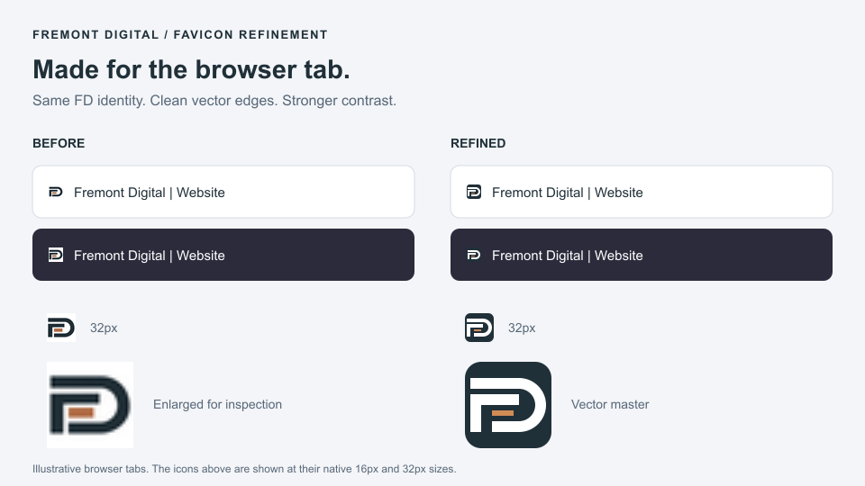

# Fremont Digital

Website and brand assets for Fremont Digital, an independent technology business in Fremont County, Colorado.

The business covers websites, digital marketing, small-business technology setup, professional photography, video and media work, computer troubleshooting, virus cleanup, phone and basic device repairs, and other suitable tech projects. The service menu is organized into Web & Digital, Business Tech, Repairs & Tech, and Photo & Media. Business inquiries: **digitalfremont@gmail.com**.

## Current stage

The owner has reviewed the header favorably and authorized the **full homepage layout**, with short working copy to refine later.

| Component | Status |
| --- | --- |
| Supplied wordmark and FD symbol | Brand sources received |
| Favicon | Draft prepared; awaiting owner review |
| Header and service navigation | Reviewed favorably; browser QA still pending |
| Full homepage layout | Coded with working copy; awaiting visual review |
| Website deployment | Not published |

The current `site/dist/` contains the full homepage: hero, service directory, business-services section, process, contact, and footer. No portfolio, featured websites, or fictional client gallery will be included. The website itself should demonstrate the quality of the work. Phone resale is recorded as a future expansion after a physical location is established.

Read [PROJECT-DECISIONS.md](PROJECT-DECISIONS.md) before making changes. Its current decisions take precedence over historical V1/V2 handoff material.

## Project layout

```text
logos/                    Owner-supplied original logo files
reviews/01-favicon/        Favicon preview, source record, and review notes
reviews/02-header/         Header review, including a self-contained HTML preview
reviews/03-layout/         Full homepage review with desktop and phone widths
site/src/                 Shared content, components, page templates, styles, scripts
site/dist/assets/favicons/ Browser icons and Apple touch icon
site/dist/assets/          Prepared wordmark, bundled fonts, and licenses
site/scripts/              Build, preview, and asset utilities
reference/                Historical V1/V2 archives and handoff documents
```

The two original logo files are PNG images without filename extensions. Their supplied names and bytes are preserved.

## Layout development

See [the layout review notes](reviews/03-layout/README.md) and [site architecture](site/ARCHITECTURE.md). Open `reviews/03-layout/offline-review.html` in a browser for an interactive full-page review without a server. The earlier header-only review is retained in `reviews/02-header/`. GitHub shows HTML source; download the review file to view it locally.

With Node.js 20 or newer, run from `site/`:

```sh
npm run build
npm run dev
```

No dependency installation is needed. The local layout review is at `http://127.0.0.1:4173/review/layout`; the header review remains at `/review/header`. Run `npm run review` to regenerate both offline reviews after changes. Homepage copy lives in `site/src/data/homepage.mjs`; the service registry remains in `site/src/data/services.mjs`.

## Favicon draft



The favicon uses the supplied FD symbol with its original colors, centered on white. [Review notes](reviews/01-favicon/README.md) describe the files and intended integration. The browser strips above are illustrative previews, not a deployed website.

To reproduce the icons and review image with Python and Pillow installed, run from the repository root:

```sh
python site/scripts/make-favicon.py
```

The script verifies icon dimensions and that the original logo file remains unchanged. It does not build or publish a website.

## Repository boundaries

Rejected artwork, local deployment configuration, temporary downloads, credentials, and development caches are excluded. Keeping this repository up to date does not authorize deploying the site.
